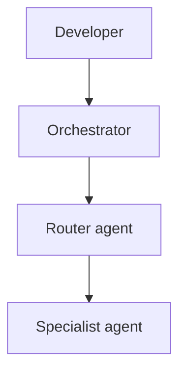
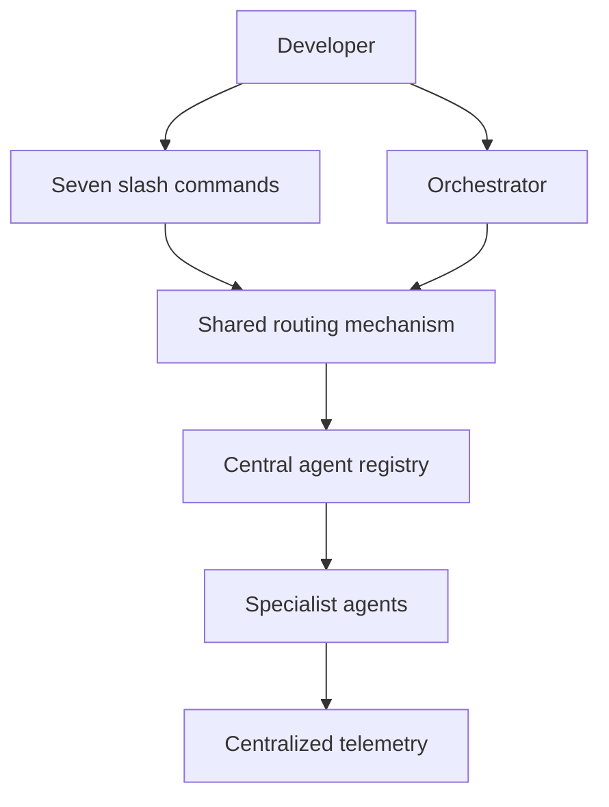

# Orchestrator vs. Agent Consolidation — Improvement Assessment

## 1. Executive summary

**Agent Consolidation can be proposed as a developer experience improvement, but not as a demonstrated architectural, performance or token optimization improvement in its current form.**

The existing Orchestrator already provides substantial agent selection, routing, delegation and workflow management capabilities. The seven router agents primarily simplify specialist access. They should complement the Orchestrator rather than become a mandatory additional execution layer.

## 2. Improvement assessment

| # | Improvement area | Assessment | Justification |
|---|---|---|---|
| 1 | Developer experience | Improvement | Seven common commands simplify interaction with specialist agents. |
| 2 | Agent discoverability | Improvement | Developers do not need to remember numerous specialist names. |
| 3 | Ease of adoption | Improvement | New developers can access capabilities without understanding the entire ecosystem. |
| 4 | Architectural simplicity | Potential regression | Additional routing layers may increase complexity while retaining specialists. |
| 5 | Functional consolidation | Not achieved | Specialist implementations and overlapping responsibilities remain unchanged. |
| 6 | Token optimization | Not demonstrated | Additional router invocations potentially increase token usage. |
| 7 | Execution reliability | Potential regression | Nested delegation was unavailable in the reported test environment. |
| 8 | Maintainability | Potential regression | Routing logic is maintained in both the Orchestrator and routers. |
| 9 | Execution performance | Not demonstrated | No comparative execution time or latency benchmarks. |
| 10 | Governance and observability | Partial improvement | Task-level telemetry is introduced, but duplication and governance consistency remain concerns. |

## 3. Is this actual agent consolidation?

| Metric | Reported count |
|---|---:|
| Original agent inventory | 46 |
| Proposed router entry points | 7 |
| Retained specialist workers | 34 |
| Specialist implementations eliminated | 0 |
| Specialist implementations functionally merged | 0 |

The proposal consolidates **entry points**, not agent implementations. A more accurate name is **Agent Interface Simplification and Unified Specialist Access**.

The inventory needs reconciliation because the report describes six routers as existing and one as newly created. The figures above are reported counts, not an independently verified repository inventory.

## 4. Genuine improvement over the existing Orchestrator

| Capability | Already available in Orchestrator? | New value from consolidation |
|---|---|---|
| Agent selection | Yes | Limited |
| Language-based routing | Yes | Limited |
| Specialist delegation | Yes | Limited |
| Workflow sequencing | Yes | Limited |
| Failure management | Yes | Limited |
| Telemetry | Yes | Additional task-level coverage |
| Security scanning routes | Partially | Scanner-specific routes |
| Accessibility routing | Partially | Dedicated accessibility entry point |
| Simplified slash commands | Not demonstrated | Significant |
| Reduced developer learning curve | Not demonstrated | Potentially significant |

The strongest justification is usability and discoverability, rather than new orchestration capabilities.

## 5. Current proposal vs. recommended architecture

### Potential redundant integration — avoid

This depicts a potential integration, not an established implementation. The proposed routers can also be used independently as top-level entry points.

### Recommended hybrid architecture

Retain the Orchestrator for complex workflows and seven commands for individual tasks. Share routing rules, agent mappings and execution contracts. Use deterministic routing where possible, with LLM fallback for ambiguous requests. The feasibility of a non-LLM routing mechanism must be validated against the host platform's extension capabilities.

## 6. Success criteria before claiming architectural improvement

| # | Success criteria | Expected result |
|---|---|---|
| 1 | Token consumption | Equal to or lower than the existing approach for equivalent tasks |
| 2 | LLM invocations | Eliminate unnecessary routing calls |
| 3 | Execution time | Equal to or faster than equivalent existing workflows |
| 4 | Routing accuracy | Correct specialist selection across representative scenarios |
| 5 | End-to-end execution | Successful specialist delegation |
| 6 | Output quality | No loss of critical specialist findings |
| 7 | Code duplication | Reduced repeated routing logic |
| 8 | Maintainability | Single source of truth for agent mappings |
| 9 | Telemetry accuracy | No duplicate lifecycle events |
| 10 | Backward compatibility | No disruption to existing Orchestrator workflows |

The reported **7/7 routing selection success** is insufficient to establish these improvements. Actual specialist execution and output equivalence were not verified by those tests.

## 7. Questions for the architecture committee

1. What problem does Agent Consolidation solve that the existing Orchestrator cannot solve?
2. Why are additional router agents necessary instead of enhancing the existing routing mechanism?
3. If none of the specialists are merged or removed, how is this considered consolidation?
4. What is the measurable reduction in token consumption and execution time?
5. How will routing rules be synchronized between the Orchestrator and seven routers?
6. How is the nested delegation limitation addressed?
7. Can the same developer experience be achieved through seven slash commands without seven additional LLM routers?
8. What is the long-term maintenance benefit?
9. How are duplicate telemetry and specialist execution prevented?
10. What are the measurable success criteria for this initiative?

## 8. Final verdict

| Proposal category | Decision |
|---|---|
| Developer experience improvement | Approve concept |
| Agent discoverability improvement | Approve concept |
| Functional agent consolidation | Not justified |
| Architectural improvement | Requires redesign |
| Token optimization initiative | Not justified without benchmarks |
| Performance improvement | Not demonstrated |
| Enterprise-wide rollout | Conditional on validation |

## 9. Recommended committee statement

The proposed Agent Consolidation provides value by simplifying developer interaction and improving specialist agent discoverability. However, the existing Orchestrator already provides substantial routing, delegation and workflow management capabilities.

Introducing additional router agents without consolidating the underlying routing logic may increase architectural complexity, token consumption and maintenance overhead.

We recommend retaining the simplified developer-facing commands while extending the existing Orchestrator with a shared routing mechanism and centralized agent registry. This would provide a more sustainable and measurable architectural improvement.

**Bottom line:** Agent Consolidation is currently a usability enhancement. To qualify as a genuine architectural improvement, it should reduce duplication, execution costs and system complexity—not simply hide them from developers.

## 10. Assessment limitations

This document captures the preceding architecture assessment, based on the previously reviewed reconstructed Orchestrator and Agent Consolidation report screenshots. It is not a new repository audit. Runtime performance, actual token overhead, permission enforcement and output equivalence remain unverified. Potential regressions are architectural risks, not measured production outcomes. The recommended hybrid design is a proposal, not a tested implementation.
