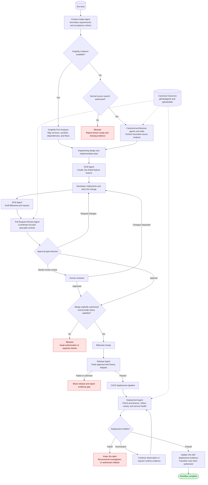

# AI-Driven Microservices Engineering Workflow

This directory contains the workflow-specific agents and skills used to implement the engineering workflow. Existing analysis resources remain canonical under `github/agents` and `github/skills` and are referenced rather than duplicated here.

## Workflow

1. `product-intake-agent` reads a Jira story, normalizes its acceptance criteria, and prepares an engineering handoff.
2. `github/agents/graphify-first-analyzer.agent.md` and the existing architecture resources identify affected services, dependencies, and execution paths.
3. Developers implement and review the change using the existing Java, Spring Boot, API, data, testing, and observability resources under `github/agents` and `github/skills`.
4. `scm-agent` creates a story-linked branch and drafts a Bitbucket pull request.
5. `pull-request-review-agent` coordinates static analysis and produces an approval recommendation.
6. `release-agent` verifies merge-history integrity.
7. `deployment-agent` observes the deployment and updates Jira only after deployment and health checks succeed.

## Flow diagram



## Layout

```text
workflow/
|-- agents/
|   `-- *.agent.md    Workflow and integration agents
`-- skills/
    `-- */SKILL.md    Integration and workflow skills
```

## External integrations

Jira and Bitbucket operations require corresponding MCP tools, APIs, or authenticated CLI commands in the runtime. Deployment monitoring requires read access to the CI/CD system and target environment. Agents must report `blocked` when a required integration is unavailable; they must never simulate an external mutation or report success without evidence.

All branch, pull-request, merge, deployment, and Jira mutations retain the user's normal authorization and approval boundaries.

## New resources

| Agent | Responsibility |
| --- | --- |
| `microservice-workflow-orchestrator` | Coordinates the complete workflow and records phase evidence. |
| `product-intake-agent` | Reads and normalizes Jira work items. |
| `scm-agent` | Creates story-linked branches and drafts Bitbucket pull requests. |
| `pull-request-review-agent` | Coordinates code analysis and returns a merge recommendation. |
| `release-agent` | Checks approval state and merge-history integrity. |
| `deployment-agent` | Monitors deployment and health checks, then updates Jira. |

| Skill | Responsibility |
| --- | --- |
| `jira-story-sync` | Read and safely update Jira stories. |
| `bitbucket-branch-management` | Create and verify story-linked branches. |
| `bitbucket-pr-drafting` | Draft pull requests with evidence-backed annotations. |
| `pull-request-approval-gate` | Evaluate deterministic approval criteria. |
| `release-history-integrity` | Verify the intended commit reached the intended branch. |
| `deployment-health-check` | Evaluate CI/CD and runtime health evidence. |

## Existing resources used by this workflow

- Architecture and impact analysis: `github/agents/graphify-first-analyzer.agent.md`, `github/agents/fullstack-project-architecture-analyzer/`, and `github/skills/fullstack-project-architecture-analyzer/`.
- Java and Spring analysis: `github/agents/code-genration/`, `github/agents/spring-backend-analysis-rts/`, and `github/skills/java-code-quality-analyzer/`.
- Review and testing: `github/skills/code-review-skill/`, `github/skills/test-coverage-analyzer/`, `github/skills/unit-test-generator/`, and the null-safety and dead-code skills.
- Delivery readiness: the existing YAML, secrets, OpenAPI, event-driven architecture, JPA/JDBC performance, logging, and observability resources.

